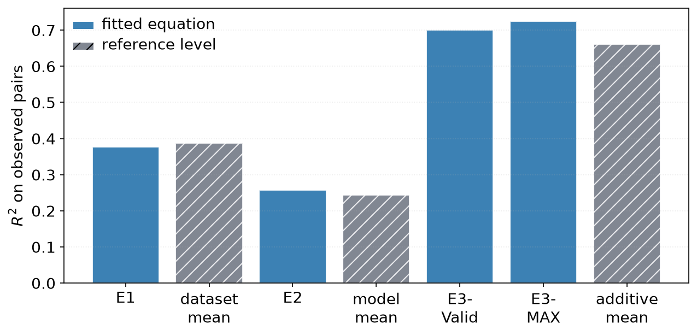

#  ml-meta-perf

**ml-meta-perf** fits short, readable equations that predict the **Matthews Correlation
Coefficient (MCC)** a classifier will reach on a dataset, from meta-features of the dataset and
of the model:

```
MCC = w1*t1 + w2*t2 + ... + wk*tk
```

In the retained grammars, each `t` is a simple expression over one to three raw features — `f`, `log(f)`, `1/f`,
`f^2`, `f1/f2`, `f1*f2`, `(f1+f2)/f3` — and each `w` is a real number in the features' own
units, so the printed equation evaluates as written.

The evaluation protocols are in-sample (**IS**), leave-one-dataset-out (**LODO**),
leave-one-model-out (**LOMO**), and doubly held out (**DHO**).

The project prioritises a readable equation and compares its fixed-form coefficient refits
with reference regressors under the same exclusions. The resulting equation can be inspected
alongside its prediction errors and representation assumptions.

> **Status:** research prototype for an academic study. The corpus is a small grid
> of datasets and models (its size is in the generated headline below). The headline equation scores are
> reported both under IS and held-out cross-validation because the two differ a lot
> at this size.

The revised corpus covers six network-slicing or service-quality datasets and fourteen
network-traffic or security datasets. It includes synthetic 6G slicing data and a centralized
application-layer representation of OCPP 1.6 intrusion-detection data. Some cells are
excluded by the minimum-training-size policy; chapter 1 counts them per dataset.

## Headline results

The equation labels are **E1** (dataset features only), **E2** (model features only),
**E3-Valid** (the retained equation, using both feature groups), and **E3-MAX** (the raw-floor
length comparison at the configured capability arity). Their arities are configured (see
the generated headline) and their length-selection rules differ.

The table below is **generated**: `ml-meta-perf` rewrites it on every run, like the result
sections of the chapters, so it cannot drift from the code.

<!-- generated: do not edit below -->

## The headline

The one table the study is summarised by, so that the summary cannot drift from the chapters. Every row is scored on the same 484 rows under the same protocols. E1, E2, and E3-Valid share the retained base configuration; E3-MAX takes the raw floor maximum at the configured capability arity (primary arity 3, capability arity 3).

| equation | features | terms | IS R2 | LODO R2 | LOMO R2 | DHO R2 | own ceiling | reached |
|---|---|---|---|---|---|---|---|---|
| E1 | dataset | 5 | 0.3766 | 0.3680 | 0.3391 | 0.3350 | 0.3866 | 0.9741 |
| E2 | model | 7 | 0.2573 | 0.1723 | 0.2256 | 0.1487 |  |  |
| E3-Valid | both | 15 | 0.6997 | 0.6771 | 0.6574 | 0.6478 |  |  |
| E3-MAX | both | 24 | 0.7247 | 0.6950 | 0.6736 | 0.6696 |  |  |

**Do not read these R² values as achievements against each other.** They share a scale but not a ceiling: E1 sees only dataset features, every row of a dataset shares one feature vector, and so E1 can predict nothing but a per-dataset constant. The `true dataset means` row gives E1's structural maximum. The last column gives only E1's fraction of that bound. E2's model-mean reference is descriptive because Processing Units Number can vary with dataset shape; no ceiling fraction is reported for E2.

**E2, E3-Valid, and E3-MAX have blank ceiling cells.** Their recorded predictors are not constant within the corresponding identity groups. The comparison table in chapter 5 also shows the additive mean-based reference. On the incomplete grid that reference is not a jointly fitted least-squares additive bound; mixed terms can represent interactions beyond marginal group effects.

<!-- end generated -->

The three primary equations differ only in which features they may draw on. All three are
fitted on the same observed rows by the same function, under **one** hyperparameter configuration
(`config/study.json`), have their length chosen by **one** rule, and are scored on the same
observed rows under the same four protocols, so the gaps between them measure the features and
nothing else.

**Their coefficient of determination (R²) values share a scale but not a ceiling, and this
is the most common way to misread the table.** E1 predicts one value per dataset, so the
variance of the true per-dataset means is the most it could *ever* reach, however good its
terms were. E1 near that ceiling is not "much worse than E3"; it is finished. The comparable
quantity for E1 is the fraction of its dataset-constant ceiling — the `reached` column.
E2 has no such bound because its structural-size proxy can vary within a model.
E3-Valid has no ceiling of that kind, because it is not constant within either group; it is
compared with the best sum of per-feature functions and the additive mean-based reference
([chapter 4](assets/docs/04-equation.md)). The latter is descriptive rather than a fitted
least-squares bound for this incomplete grid.

**E3-Valid and E3-MAX have separate roles.** E3-Valid's length is the start of the first
sustained plateau of its worst-protocol curve: the first knee (found by multi-Kneedle,
[`kneeliverse`](https://github.com/mariolpantunes/knee)) of the smoothed curve after which it
stops improving, or its smoothed maximum when every knee is still followed by real gains.
E3-MAX takes the raw maximum of the curve at the configured capability arity
([chapter 3](assets/docs/03-term-selection.md)).



### What the documentation develops

- **One equation, refit — not one search per fold.** The equation's form is the claim; the
  folds recalibrate its constants and test whether the claim survives unseen data. Re-running
  term selection inside every fold answers a different question about the search, and much
  of the transfer it reports belongs to choosing the terms on all rows — see the limitations
  of [chapter 3](assets/docs/03-term-selection.md) and [chapter 5](assets/docs/05-evaluation.md).
- **One configuration, chosen by the published equation's own criterion.** The shared
  hyperparameters come from a sweep (`ml-meta-perf-search`) that applies the study's length
  rule to every configuration and, among those tied on R², proposes the one whose
  doubly-held-out predictions rank the models best. Each equation searches every feature it
  may use; the configuration holds hyperparameters only.
- **The corpus describes datasets far better than models.** The model side's descriptors are
  a heuristic ordinal over the ten learner families and four mechanism categories — all
  assigned by the study rather than calibrated measurements from training runs.
  What they cannot do is describe a method nobody has classified.
  [Chapter 1](assets/docs/01-dataset.md).
- **Mixed dataset×model terms carry a large share of the equation**, which is where "which
  model suits which data" lives; the shares by feature group are generated in
  [chapter 4](assets/docs/04-equation.md).
- **No single meta-feature carries it**, which is why the equation needs many terms rather
  than two, and **one interaction component is worth a measurable R², of which the equation
  reaches part** — both measured in [chapter 4](assets/docs/04-equation.md).
- **Ten best practices from the literature, weighed against the corpus** — which are
  supported, qualified or untestable here is generated in [chapter 6](assets/docs/06-practices.md).

## Documentation

The rationale, methodology and full results live in
**[`assets/docs/`](assets/docs/index.md)**, written as a paper and carrying the generated
figures.

| | | modules |
|---|---|---|
| 0 | [Related work and positioning](assets/docs/00-related-work.md) | — |
| 1 | [The dataset](assets/docs/01-dataset.md) | `ml_meta_perf.data` |
| 2 | [The additive model](assets/docs/02-additive-model.md) | `ml_meta_perf.terms`, `ml_meta_perf.model` |
| 3 | [Term generation and selection](assets/docs/03-term-selection.md) | `ml_meta_perf.search`, `ml_meta_perf.fit`, `ml_meta_perf.analysis`, `ml_meta_perf.selection` |
| 4 | [The equation](assets/docs/04-equation.md) | `ml_meta_perf.experiment`, `ml_meta_perf.validate` |
| 5 | [Evaluation](assets/docs/05-evaluation.md) | `ml_meta_perf.validate`, `ml_meta_perf.stats` |
| 6 | [Best practices against the equation](assets/docs/06-practices.md) | `ml_meta_perf.practices`, `ml_meta_perf.attribution`, `ml_meta_perf.guidance` |
| 7 | [Other targets](assets/docs/07-generic-targets.md) | `ml_meta_perf.model`, `ml_meta_perf.validate`, `ml_meta_perf.data` |

Each chapter is self-contained: it ends with its own limitations, and chapters 4, 5 and 6
close with a **generated section** that `ml_meta_perf.report` rewrites on every run. Prose
above the marker is hand-written and describes the method; everything below it is computed
from the fitted equation, so no chapter can carry a stale table.

The application programming interface (API) reference is generated from the module docstrings with `pdoc` and published to
GitHub Pages by `.github/workflows/docs.yml`; each module links back to the chapter
covering it.

## Installation

Python 3.12+. Runtime dependencies are **Polars**, **NumPy**, **Matplotlib**,
**scikit-learn**, **joblib**, **jsonargparse** (reads `config/study.json`), and
**[kneeliverse](https://github.com/mariolpantunes/knee)** (knee detection for the
equation-length rule).

scikit-learn is there for one thing: the opaque-regressor comparison in
[chapter 5](assets/docs/05-evaluation.md), which prices the other side of the trade this
study is making. It brings SciPy with it, which the project refused for a long time on size
grounds — `ml_meta_perf.stats` exists because four statistics were not worth the dependency,
and that reasoning still holds for those four. What changed the answer is that the comparison
the chapters lean on hardest was measured once by hand and reproducible by nobody. An
unreproducible headline is a worse cost than a large wheel.

```bash
python3.12 -m venv venv
venv/bin/python -m pip install -e ".[reproducibility]"
```

On Windows PowerShell, create the environment with `py -3.12 -m venv venv` and use
`venv\Scripts\python.exe` or `venv\Scripts\pre-commit.exe` in place of the corresponding
`venv/bin/` command.

`pyproject.toml` is the only dependency manifest. The `reproducibility` extra freezes the
complete runtime used for the reference run; a plain `venv/bin/python -m pip install -e .`
installs the supported dependency ranges declared by the package instead.

## Meta-Dataset Generation

The generated corpus is versioned at
[`dataset/meta_dataset.csv`](dataset/meta_dataset.csv), outside the package. The study finds
it from a source checkout, or under the working directory when the package is installed and
run from a clone; anywhere else, pass `--data`. The scripts and
configuration needed to rebuild that corpus live in
[`meta_dataset_pipeline/`](meta_dataset_pipeline/).

The revised data and analysis scripts are supplied in the accompanying study supplement
and workspace snapshot. The earlier public release v1.0.0 contains a different corpus;
no new public release is implied by this revision. The construction protocol uses seeds
5, 7, 11, 13 and 42, yielding 2,420 evaluation records before best-run selection.

The meta-dataset pipeline has additional dependencies, including `pymfe` and the tabular
model libraries used during the original model-evaluation stages. Install them explicitly:

```bash
venv/bin/python -m pip install -e ".[meta-dataset]"
```

On Windows PowerShell:

```powershell
venv\Scripts\python.exe -m pip install -e ".[meta-dataset]"
```

That folder is intentionally separate from the package code:

- `meta_dataset_pipeline/` contains the raw-corpus stages and can regenerate a candidate
  corpus at `meta_dataset_pipeline/results/meta_dataset.csv`;
- `src/ml_meta_perf/data.py` loads and validates the published corpus schema;
- `dataset/meta_dataset.csv` is the versioned corpus consumed by the library and
  command-line tool, and is updated only when the regenerated corpus is accepted.

See [`meta_dataset_pipeline/README.md`](meta_dataset_pipeline/README.md) for the stage
order, local token configuration, ignored raw dataset files, and instructions for comparing
or publishing a regenerated corpus.

## Running it

**One command runs every phase**: screening, fitting E1, E2, E3-Valid and E3-MAX, cross-validating under all four protocols, pricing the opaque comparison, extracting the
practices, writing the figures, and splicing the generated sections into the chapters.

```bash
venv/bin/ml-meta-perf          # or: PYTHONPATH=src venv/bin/python -m ml_meta_perf
```

Runtime depends on the configured search and reference regressors. The DHO comparison
refits each reference estimator once per observed cell. A full run writes:

| | |
|---|---|
| [`assets/docs/`](assets/docs/index.md), `README.md` | the index, chapters 1, 3, 4, 5 and 6, and this README's headline — their generated sections rewritten in place |
| `results/e1.json`, `e2.json`, `e3.json` | the fitted equations, reloadable |
| `results/*.csv` | the study's tables — curves, baselines, oracles, stability, practices |
| `assets/figures/*.png`, `*.pdf` | the figure set, raster and vector, numbered in the order the study presents it |

Everything printed and written is derived from the run. **The report is generated by
`ml_meta_perf.report`, not written by hand.** It ranks terms by standardised weight, writes a
sentence per major term, groups terms into the blocks that move together, and reports which
features and which grammar operations the search actually used — so a flat equation with no
dominant term is still readable, at a larger unit than one term.

Every phase can be skipped and every destination redirected, so the same entry point
serves a full study and a numbers-only run:

```bash
ml-meta-perf --no-figures                        # tables and report only
ml-meta-perf --quiet --no-tables --no-report     # figures only
ml-meta-perf --output results --docs assets/docs --figures figures
```

`ml-meta-perf --help` lists all of them. There is no smoke-test flag: `--quick` was a preset
of three flags that already exist, and it quietly reached two things they did not, which is
how it came to advertise "seconds" while still paying for the full opaque comparison. The
wiring check is `python -m unittest discover -s tests`, which takes about a minute and checks more.

The shared configuration is chosen by a separate command, `ml-meta-perf-search`: it fits every
point of the grid in `config/study.json`'s `sweep` section once, applies the study's own length
rule to each, and among the configurations tied on R² at a readable length proposes the one
whose doubly-held-out predictions rank the models best. It writes `proposed_study.json`;
adopting it is a reviewed edit to `config/study.json`.

FlexFL targets are available in both commands; see [the FlexFL guide](FLEXFL.md). The study CLI writes `equation.json`, `equation.txt`, `curve.csv`,
`term_effects.csv` and `group_shares.csv` under `<output>/flexfl/<slug>/`.
A FlexFL target is a study file in `config/flexfl/` (`--config config/flexfl/total_time_s.json`); `--response.transform log1p` writes to `<output>/flexfl/<slug>-log1p/`.

**Discrete and binary features do not work as independent features here.** The equation is a sum
of terms, each a product of transformed features. A 0/1 indicator inside a product switches the
term off on the rows where it is 0, so its weight is a slope that exists in one group only; in a
sum it is an offset, since $d^2 = d$ and $\sqrt{d} = d$; and a complete set of one-hot columns
sums to the intercept. Such columns are accepted (the FlexFL corpus has them, for the algorithm
and the data strategy), and are read as "this group sits higher or lower by $w$", never as a
quantity whose effect scales. The derivation is in [chapter 7](assets/docs/07-generic-targets.md).

**One note on threading.** The inner loop is ~87k solves of matrices no larger than 32×32,
far below the size where Basic Linear Algebra Subprograms (BLAS) parallelism pays: threading
buys no wall time and burns 3.5× the central processing unit (CPU) spinning. Setting
`OPENBLAS_NUM_THREADS=1` costs nothing and saves the CPU; it is
left to the caller rather than forced from inside a library.

### Configuration

Every tuned value lives in **`config/study.json`** and nowhere else: the command line has no
defaults of its own for them. The file is read with `jsonargparse`, so `--config other.json`
replaces it, any field can be overridden as a dotted flag, and `--print_config` prints the
effective configuration. E1, E2 and E3 share every one of these values.

The same file **describes the problem**, in four sections that hold no tuned value, and says which equations to fit:

| section | keys | what it says |
|---|---|---|
| `corpus` | `path`, `dataset_column`, `model_column` | the CSV, and the columns that name the groups held out by the protocols (`model_column` may be `null`: one grouping factor) |
| `corpus` (optional) | `row_filter`, `require`, `single_valued`, `drop_missing_response`, `drop_constant_features` | how to read a corpus that is not clean: keep one subset of rows (`{column, equals, label}`), reject a stale corpus that lacks a column (`{column, hint}`), insist that some columns hold one value over the rows fitted, drop and report rows with an empty target, remove features that never vary |
| `response` | `column`, `bounds`, `transform` | the target, the `[low, high]` it can take (either end may be `null`: a time is `[0, null]`, MCC `[-1, 1]`, and `null` for no bounds), and `none` or `log1p` to fit `log(1 + y)` ([chapter 7](assets/docs/07-generic-targets.md), section 7.5) |
| `features` | `dataset`, `model` | which columns describe a dataset and which describe a model |
| `side_files` | `taxonomy`, `ordinals`, `glossary` | static facts that are not columns of the corpus: the learner family of every model, the assigned ordinal behind each model-descriptor column (with its provenance), and the meaning of each feature; each a JSON file in `dataset/`, or `null` when the study has none |

`equations` lists which of E1, E2 and E3 to fit (`["E1", "E2", "E3"]` for the MCC study). `protocols` lists the protocols every equation is scored under, from `IS`, `LODO`, `LOMO`, `DHO` (all four for MCC; `["IS", "LODO"]` for FlexFL, whose model factor is a training mode; LOMO and DHO need a model column). `grammar.exclude` maps a feature to the operations it may not take part in (`log`, `sqrt`, `sq`, `inv`; `inv` means never a divisor), for features that could reach zero in future data; empty for every shipped study ([chapter 7](assets/docs/07-generic-targets.md), section 7.2b). A study of another target or another corpus is another file of this shape; nothing about a problem
is in the code. The mathematics of the description is in [chapter 7](assets/docs/07-generic-targets.md).

| setting | value | what it does |
|---|---|---|
| `search.max_abs_zscore` | 3.5 | largest standard score a term may reach before it is rejected as a spike |
| `search.penalty` | 0.1 | ridge penalty on standardised terms |
| `search.pool_size` | 600 | terms surviving screening into the beam |
| `search.max_terms` | 30 | longest equation the search explores (the curve's horizon, not the published length) |
| `search.beam_width` | 6 | beam width |
| `search.max_arity` | 3 | raw features per term — see [chapter 2](assets/docs/02-additive-model.md) |
| `selection.delta` | 0.01 | largest smoothed-floor gain over the window that still counts as a plateau |
| `selection.window` | 4 | lengths after a candidate that must stay within `delta` |
| `selection.smoothing` | 3 | width of the running median applied to the worst-protocol curve |
| `selection.capability_arity` | 3 | arity used by E3-MAX; matches the primary grammar in this configuration |
| `opaque.forest_trees` | 100 | random forest size |
| `opaque.forest_max_features` | 0.33 | share of features considered at each forest split |
| `opaque.boosting_stages` | 50 | gradient boosting stages |
| `opaque.boosting_learning_rate` | 0.1 | gradient boosting learning rate |
| `opaque.boosting_max_depth` | 3 | gradient boosting tree depth |

The file's `sweep` section is the grid `ml-meta-perf-search` explores and how it chooses among
close candidates. A test checks this table against the file.

Run options are ordinary flags:

| flag | default | what it does |
|---|---|---|
| `--config` | `config/study.json` | the study configuration |
| `--response.transform` | `none` | `log1p` fits `log(1 + y)` of a target that cannot be negative; any field of the study file can be overridden as a dotted flag |
| `--data` | `corpus.path` of the study file | the meta-dataset to fit (overrides the file; used as given, relative to the working directory) |
| `--output` | `results` | where the equations and comma-separated value (CSV) tables go |
| `--figures` | `assets/figures` | where the figures go |
| `--docs` | `assets/docs` | chapter directory whose generated sections are rewritten |
| `--readme` | `README.md` | README whose generated headline is rewritten |
| `--phase` | all | comma-separated subset of `screen`, `equations`, `validation`, `practices`, `figures`, `report` |
| `--no-figures`, `--no-tables`, `--no-report`, `--quiet` | off | skip an output |

```bash
# a shorter horizon and a heavier ridge, no figures. The published length is not a flag:
# it is derived from each equation's own curve
ml-meta-perf --search.max_terms 12 --search.penalty 10 --output runs/short --no-figures --no-report

# explicitly use the retained arity-three grammar for every equation
ml-meta-perf --search.max_arity 3 --output runs/arity3 --figures runs/arity3/figures --no-report

# just the screening table
ml-meta-perf --phase screen --output runs/screen --no-figures --no-report

# re-run the configuration sweep; writes results/sweep/proposed_study.json for review
ml-meta-perf-search --output results/sweep
```

## Using it as a library

```python
from ml_meta_perf import build_library, columns_as_arrays, default_schema, load, load_config, search, target

schema = default_schema()          # the columns and features config/study.json describes
frame = load()
columns = columns_as_arrays(frame, schema.features)
library = build_library(schema.dataset_features, schema.model_features, columns, max_arity=2, max_abs_zscore=4.0)

config = load_config().search
equation = search(library, target(frame), max_terms=config.max_terms, penalty=config.penalty).best()

print(equation)                    # human-readable, with standardised betas
print(equation.to_latex())         # for the paper
equation.save("e3.json")           # round-trips exactly
predictions = equation.predict(columns)
```

Extracting guidance and figures from a fitted equation:

```python
from ml_meta_perf.practices import best_practices, render
from ml_meta_perf.plots import practice_effects

practices = best_practices(equation, columns)     # pass a stability table to rate them
print(render(practices))
practice_effects(practices, "practice_effects.png")
```

## Figures

`--figures <dir>` writes the figure set, each as a Portable Network Graphics (PNG) file and
a Portable Document Format (PDF) file on a transparent
background. **Files are numbered by their position in the set** — `01_equation_comparison.png`,
`02_term_count_curve.png` and so on — so a figure can be named by its number in a review or a
caption. `ml_meta_perf.figures.FIGURE_ORDER` is the single place that order is written down,
and `generate` refuses to write a set that does not match it. **None carries a title or an
annotation** — they are
made for LaTeX `figure` environments where the caption does that work, and text baked into
a PNG cannot be restyled or translated. `ml_meta_perf.figures.captions()` returns a suggested
caption per file, including the disclosures deliberately kept out of the images.

## Layout

```
src/ml_meta_perf/
    data.py         loading, schema validation, aggregation, feature glossary
    terms.py        the term vocabulary and its admissibility rules
    stats.py        pearson, spearman, ranks, R2 (R²), mean absolute error (MAE),
                    root mean squared error (RMSE), and symmetric mean absolute percentage
                    error (SMAPE), written out
    opaque.py       the opaque-regressor comparison (scikit-learn), same protocols
    analysis.py     correlation screening, redundancy clustering
    search.py       screening, beam search, refinement, pruning
    fit.py          standardisation, the ridge solve, and reading weights back out
    model.py        the Equation object: predict, render, serialise
    validate.py     leave-one-group-out protocols, baselines, oracles
    selection.py    the equation-length rule (smoothed worst-protocol curve, multi-Kneedle,
                    first sustained plateau) and the E3-MAX bound
    attribution.py  per-term effects, group shares, variance decomposition
    practices.py    per-feature associations measured from a fitted equation
    guidance.py     literature best practices, weighed against what the study measured
    plots.py        the figures (Matplotlib, Agg, headless, no embedded text)
    figures.py      the figure set and suggested LaTeX captions
    report.py       the generated report: term importance and written analysis
    identity.py     per-model effects, measuring the ceiling on model descriptors
    experiment.py   the end-to-end study: one configuration, one length rule, E1/E2/E3/E3-MAX
    config.py       the typed schema of config/study.json and its loader
    sweep.py        `ml-meta-perf-search`: the configuration sweep that proposes study.json
    cli.py          the jsonargparse pipeline: `ml-meta-perf`, `python -m ml_meta_perf`
config/             study.json, every tuned hyperparameter
dataset/            meta_dataset.csv, the versioned corpus
assets/docs/        the study chapters, hand-written with generated sections spliced in
assets/figures/     generated figures
results/            generated equations and tables
meta_dataset_pipeline/  raw-corpus pipeline used to regenerate meta_dataset.csv
tests/              unittest suite
.github/workflows/  continuous integration (CI) on 3.12 and 3.14, and the published API reference
pyproject.toml      the package, its dependency ranges, and the extras: `dev` (pinned
                    tooling), `reproducibility` (exact reference runtime), `meta-dataset`
```

## Development

`.pre-commit-config.yaml` is the gate and `.github/workflows/main.yml` runs the same five
checks on Python 3.12 and 3.14, reading their settings from `pyproject.toml`. The hooks use
a pre-commit-managed environment, so the installed Git hook runs on both Windows and Linux.

```bash
python3 -m venv venv
venv/bin/pip install -e ".[dev]"
venv/bin/pre-commit install
venv/bin/pre-commit run --all-files   # ruff, ruff format --check, basedpyright, vulture, unittest
```

The `dev` extra installs the project editable and pins pre-commit plus the three
static-analysis tools, at the versions continuous integration (CI) installs. `pyproject.toml`
defines the supported runtime dependency ranges; its `reproducibility` extra freezes the
complete environment used for the reference experiment.

## Citation

See [`CITATION.cff`](CITATION.cff).

## License

MIT — see [`LICENSE`](LICENSE).
