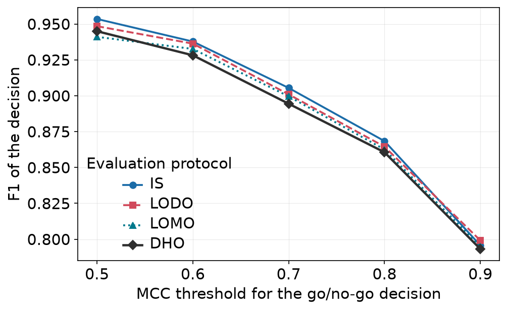
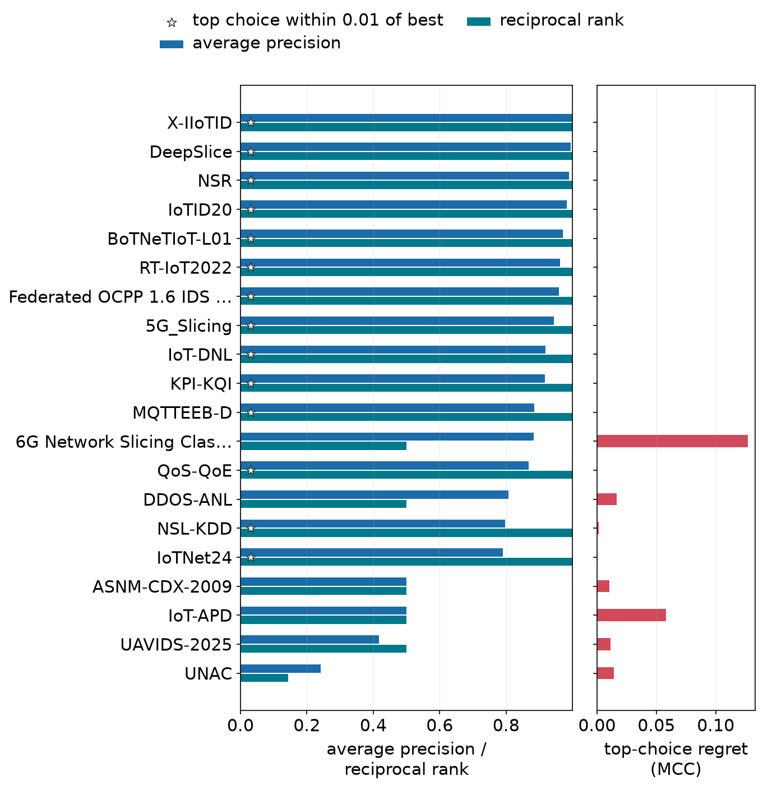

# 5. Evaluation

*Implemented in `ml_meta_perf.validate` and `ml_meta_perf.stats`.*

The metric abbreviations used in this chapter are coefficient of determination (**R²**),
Matthews Correlation Coefficient (**MCC**), mean absolute error (**MAE**), root mean squared
error (**RMSE**), symmetric mean absolute percentage error (**SMAPE**), average precision
(**AP**), mean reciprocal rank (**MRR**), hit at rank one (**Hit@1**), and F1 score (**F1**).
The equation labels are **E1** (dataset features only), **E2** (model features only),
**E3-Valid** (the plateau-selected equation using both feature groups), and **E3-MAX**
(the maximum-capability equation using both feature groups).
The evaluation protocols are in-sample (**IS**), leave-one-dataset-out (**LODO**),
leave-one-model-out (**LOMO**), and doubly held out (**DHO**).

## Four protocols

| protocol | fitted on | scored on | question answered |
|---|---|---|---|
| **IS** | all observed rows | the same observed rows | how well does the equation *describe* the data |
| **LODO** | 19 datasets | the held-out 20th, rotated | what will these models score on a dataset nobody has run |
| **LOMO** | 24 models | the held-out 25th, rotated | what will a new model score on datasets we know |
| **DHO** | every row sharing neither the dataset nor the model | one observed (dataset, model) cell, rotated over all observed cells | what will *this* model score on *this* dataset, when neither has been run |

**The fourth is the question the study is actually for**, and it is the strictest of the
four: LODO still shows a predictor the held-out learner on nineteen other
problems, and LOMO still shows it the held-out dataset. Only DHO
denies both, which makes it the one place an equation and an opaque regressor are denied the
same things. `ml_meta_perf.validate.cross_validate_doubly_held_out` implements it, one refit
per observed cell rather than per group.

It is also where the study's decisions are tested. Every equation's length is read off
`selection.floor_curve`, the **minimum over all four** protocols — so in practice off DHO —
and the shared configuration was chosen by how well E3-Valid's DHO predictions rank the models
([chapter 3](03-term-selection.md#how-the-configuration-itself-was-chosen)). The ranking and
threshold tables report E3-Valid under DHO.

IS describes fit to the observed corpus. Restricted terms, bounded arity, and ridge fitting
limit capacity without guaranteeing absence of overfitting. The differences between IS and
coefficient-refit protocols are useful diagnostics, conditional on global form selection.

## One equation, refit — not one search per fold

The equation's form is selected once; each exclusion refits its term statistics,
intercept, and ridge coefficients. `cross_validate_fixed_form` therefore assesses this
selected form under restricted fitting histories. Because discovery used all rows, these
scores are conditional and can be optimistic for the complete discovery procedure.
Repeating term selection within LODO folds provides a separate sensitivity diagnostic.

### What licenses fixing the form

Term reselection frequencies describe how often the selected expressions return after
a dataset is excluded. A separate diagnostic also scores predictions from those
within-fold searches. It still retains global configuration and requested length, and is
not a fully nested assessment of discovery. Stability of some terms cannot by itself
remove selection optimism from the fixed-form scores.

### What is still shared across folds

The vocabulary, numerical admissibility, initial screening, length selection, and
configuration selection use the full corpus. Only coefficient recalibration and its
standardisation are isolated in the primary refits. This shared information is a limitation
of the fixed-form experiment; a complete discovery assessment needs outer grouped folds.

## Random k-fold is a leak, not a protocol

Dataset meta-features are **constant across a dataset's observed rows**. A random split
therefore puts the same dataset on both sides of the fold and does not test transfer to an
unseen dataset.

The same equation under all three splits is the generated
[Why a random split is not a protocol](#why-a-random-split-is-not-a-protocol) table below —
this section does not keep a second copy, for the reason given
[above](#where-the-numbers-are).

The generated table measures the random-fold versus grouped-refit difference for the
current equation. Its size can change with the corpus and form; a small observed gap does
not make random splitting a test of transfer to unseen datasets.

A gap of that kind is a diagnostic worth keeping even when it reads zero.
`ml_meta_perf.validate.random_kfold_groups` exists **only** to produce this comparison; it is
never used to score a result.

This is the same concern as subject-wise splitting in clinical machine learning, and the
same recommendation made by community reporting standards (Walsh et al., 2021).

## Metrics

| metric | units | why |
|---|---|---|
| **R²** | — | variance explained; the comparable headline |
| **MAE** | MCC | the honest error headline — what a practitioner actually asks |
| RMSE | MCC | outlier-sensitive companion to MAE |
| SMAPE | % | scale-free, but see the caveat below |
| Spearman | — | rank quality over all observed rows, insensitive to the MCC ceiling |

Spearman is reported for the regression task and **not** used to compare model rankings.
Computed over all observed rows, it mixes between-dataset and within-dataset order and can assign
correlation even to a predictor that is constant within each held-out group. Average
precision, reciprocal rank, hit@1, and regret instead evaluate each dataset's model list and
weight its head, which is where a recommendation is actually read.

### Where the numbers are

Every equation on every metric under every protocol, and every trivial predictor beside them,
is in the generated [How well it does](#how-well-it-does) section below. **This chapter used
to carry its own copy of that table and it went stale twice** — once when the fourth protocol
was added and the copy still showed three, and once when the three equations were put on one
configuration and E1 and E2 both moved. A hand-written table beside a generated one is a
second source of truth for numbers that have exactly one.

Two things about it are worth saying in prose, because they are not visible in the table.

**The hardest trivial predictor is a different one for R² than for MAE and SMAPE.** MAE is
minimised by the median and R² by the mean, so a comparison that reports only mean baselines
is not reading each metric against the predictor that is hardest to beat on it. Both centres
are reported, which is what the `at both centres` sub-table below is for.

### A caveat on R²

R² uses the mean of the evaluated targets in its denominator. Scores over aggregated
dataset means and scores over observed pairs therefore measure different quantities.
All three primary equations here are fitted and scored on the same observed pairs.

### A caveat on SMAPE

SMAPE divides by $|y| + |\hat{y}|$, and the revised corpus contains valid zero-MCC observations. Each
contributes the full 200% unless the prediction is also exactly 0, so the metric is
dominated by the rows the equation is already known to handle worst rather than by its
typical error. It is reported because it is scale-free and was requested, but MAE is the
honest headline for a target that legitimately passes through zero.

## Two questions the R² does not answer

Regression accuracy, threshold qualification, and classifier ranking are different
questions. The equation is evaluated on all three.

### Will this model clear a bar?

Given a dataset and a threshold, does the equation put each model on the right side of it?
`ml_meta_perf.validate.decision_report` scores that at five thresholds, against the accuracy
of always answering with the larger class — the bar any such rule must clear.

The table is in the generated section below, at all five thresholds and with precision,
recall and MCC beside the three columns named here. It is not repeated at this point in the
chapter: a hand-copied version stood here until 2026-09-07 and had drifted from the generated
one 240 lines further down the same file.

The legend uses the four protocol abbreviations: **IS**, **LODO**, **LOMO**, and **DHO**.

F1 and binary-decision MCC accompany accuracy because the qualifying class proportions
change with the threshold. The majority-class reference and precision/recall reveal the
trade-off between accepting an inadequate model and rejecting a suitable one.

### Which model should I run?

Ranking relevance means observed MCC within 0.01 of the dataset's best, accommodating
near-best ties. This band is an operational tolerance, not statistical equivalence.
AP, MRR, Hit@1, and regret are averaged equally over datasets. Every result names its
protocol, and historical baselines are compared under matched LODO information.

In the figure, a star marks a **top choice within 0.01 MCC of the dataset's best** observed
model, matching the relevance tolerance used by AP, MRR, and hit@1.

The per-dataset plot exposes variation in top-choice regret that an overall mean hides.
The revised dataset names and outcomes are generated from the current corpus.

## Baselines

An equation earns its place only by beating the obvious alternatives, and there are more of
them than one. Every trivial predictor is reported at **two centres**, because the metrics
disagree about which is the honest opponent: the mean minimises squared error, the median
minimises absolute error. An MAE quoted against a mean baseline is quoted against a predictor
that is not minimising the metric it is being judged on.

The table is generated: [The trivial predictors, at both
centres](#the-trivial-predictors-at-both-centres), with the strongest of each kind picked out
per metric beneath it.

Each metric must be compared with the relevant baseline under the same protocol. The
generated table reports both centers without assuming one wins on every measure.

These centers are computed from the fitting groups only by
`validate.baseline_group_centre`; the evaluated observation is excluded.

Every per-model baseline also has a limit no metric shows: it is **empty under
LOMO**. A held-out model has no training row, so "how well does this model
usually do" does not exist. The per-dataset baselines remain defined under that protocol;
the per-model baselines are competitors only when model history is available.

### On ranking, compare matched historical baselines

Historical per-model means and medians require observations of that learner on other
datasets, so their matched comparison uses LODO. The generated table reports each metric,
with paired dataset-level AP comparisons. Intervals containing zero do not establish a
ranking advantage. Under DHO the target learner's history is absent and these baselines
are unavailable.

### Numerical estimation and threshold decisions

The regression tables report numerical estimation; the decision tables report threshold
qualification. They answer different questions from near-best ranking, so an advantage on
one should not be inferred from another. Each comparison retains its stated protocol and
information availability.

## Term stability

Exact-term frequencies across 20 LODO reselection searches accompany the coefficients.
Terms that never reappear receive frequency zero. This measures expression recurrence,
rather than coefficient-sign stability or independent discovery performance.

## Flexible regression references

RidgeCV, random forest, and gradient boosting use all 18 raw descriptors with the same
outer partitions and prediction bounds. Their representations and prior selection budgets
differ from those of the globally selected equation. Forest and boosting settings are
retained study-development choices, without fresh tuning on the revised corpus.

Read regression, ranking, and threshold outcomes separately: a higher MAP need not imply
higher Hit@1 or lower regret. These conditional comparisons do not establish independent
superiority of the full symbolic-discovery procedure.

<!-- generated: do not edit below -->

## How well it does

| protocol | R² | MAE | RMSE | n |
|---|---|---|---|---|
| IS | 0.6997 | 0.1176 | 0.1834 | 484 |
| LODO | 0.6771 | 0.1231 | 0.1901 | 484 |
| LOMO | 0.6574 | 0.1247 | 0.1958 | 484 |
| DHO | 0.6478 | 0.1280 | 0.1986 | 484 |

Cross-validated rows hold out a whole dataset or a whole model, so the equation is scored on a group it has never seen. That is the number that matters, and it is well below the IS value at this sample size.

Against the baselines and descriptive group-mean references:

| equation | n_terms | r2 | mae | rmse | smape | spearman | n |
|---|---|---|---|---|---|---|---|
| E1, dataset only (5 terms) | 5 | 0.3766 | 0.1943 | 0.2642 | 39.4222 | 0.6886 | 484 |
| E1 reference: true dataset means |  | 0.3866 | 0.1877 | 0.2621 | 38.6151 | 0.6940 | 484 |
| E2, model only (7 terms) | 7 | 0.2573 | 0.2274 | 0.2884 | 43.2440 | 0.4619 | 484 |
| E2 reference: true model means |  | 0.2443 | 0.2231 | 0.2909 | 42.8625 | 0.4200 | 484 |
| E3-Valid, dataset + model (15 terms) | 15 | 0.6997 | 0.1176 | 0.1834 | 30.9385 | 0.8358 | 484 |
| E3-MAX, arity 3 (24 terms) | 24 | 0.7247 | 0.1131 | 0.1756 | 30.9755 | 0.8307 | 484 |
| reference: additive mean-based reference |  | 0.6611 | 0.1404 | 0.1948 | 32.3559 | 0.7903 | 484 |

#### The trivial predictors, at both centres

| baseline | r2 | mae | rmse | smape | spearman | n |
|---|---|---|---|---|---|---|
| global mean (LODO) | -0.0432 | 0.2831 | 0.3417 | 47.5026 | -0.6919 | 484 |
| per-model mean (LODO) | 0.1598 | 0.2352 | 0.3067 | 44.1996 | 0.2935 | 484 |
| global mean (LOMO) | -0.0207 | 0.2802 | 0.3381 | 47.2088 | -0.4182 | 484 |
| per-dataset mean (LOMO) | 0.3333 | 0.1958 | 0.2732 | 39.5832 | 0.6267 | 484 |
| global median (LODO) | -0.2821 | 0.2386 | 0.3789 | 39.7048 | -0.7023 | 484 |
| per-model median (LODO) | 0.0097 | 0.2238 | 0.3330 | 42.0019 | 0.3326 | 484 |
| global median (LOMO) | -0.2732 | 0.2361 | 0.3775 | 39.4625 | -0.4175 | 484 |
| per-dataset median (LOMO) | 0.1668 | 0.1784 | 0.3054 | 36.9503 | 0.6525 | 484 |
| additive mean-based reference (IS) | 0.6611 | 0.1404 | 0.1948 | 32.3559 | 0.7903 | 484 |

Every trivial predictor appears at its mean and at its median, because the metrics disagree about which is the honest opponent: the mean minimises squared error and the median minimises absolute error, so an MAE quoted against a mean baseline is quoted against a predictor that is not minimising the metric it is judged on. Reading the strongest baseline of each kind, per metric:

| metric | strongest mean baseline | strongest median baseline | harder |
|---|---|---|---|
| R2 | per-dataset mean (LOMO) (0.3333) | per-dataset median (LOMO) (0.1668) | **mean** |
| MAE | per-dataset mean (LOMO) (0.1958) | per-dataset median (LOMO) (0.1784) | **median** |
| SMAPE | per-dataset mean (LOMO) (39.5832) | per-dataset median (LOMO) (36.9503) | **median** |

## Acting on it

R² is the wrong question for a practitioner, who asks whether a model will work on some data rather than what its MCC will be to three decimals. Thresholding both the prediction and the truth turns the equation into a go/no-go rule, scored here on held-out datasets:

| threshold | accuracy | majority | precision | recall | mcc | f1 | map | n_positive |
|---|---|---|---|---|---|---|---|---|
| 0.5000 | 0.9112 | 0.7831 | 0.9179 | 0.9736 | 0.7244 | 0.9449 | 0.9744 | 379 |
| 0.6000 | 0.8926 | 0.7479 | 0.9282 | 0.9282 | 0.7151 | 0.9282 | 0.9763 | 362 |
| 0.7000 | 0.8595 | 0.6921 | 0.9320 | 0.8597 | 0.6906 | 0.8944 | 0.9602 | 335 |
| 0.8000 | 0.8326 | 0.6632 | 0.9615 | 0.7788 | 0.6800 | 0.8606 | 0.9574 | 321 |
| 0.9000 | 0.7996 | 0.5496 | 0.9163 | 0.6992 | 0.6264 | 0.7932 | 0.9074 | 266 |

`majority` is the floor any such rule has to clear. The harder comparison is a predictor that answers "how well does this model usually do", thresholded the same way — at both centres, for the reason the error metrics report both:

| predictor | threshold | accuracy | majority | precision | recall | mcc | f1 | map | n_positive |
|---|---|---|---|---|---|---|---|---|---|
| equation (IS) | 0.5000 | 0.9256 | 0.7831 | 0.9342 | 0.9736 | 0.7724 | 0.9535 | 0.9776 | 379 |
| equation (IS) | 0.6000 | 0.9070 | 0.7479 | 0.9391 | 0.9365 | 0.7541 | 0.9378 | 0.9807 | 362 |
| equation (IS) | 0.7000 | 0.8740 | 0.6921 | 0.9419 | 0.8716 | 0.7223 | 0.9054 | 0.9642 | 335 |
| equation (IS) | 0.8000 | 0.8409 | 0.6632 | 0.9621 | 0.7913 | 0.6928 | 0.8684 | 0.9628 | 321 |
| equation (IS) | 0.9000 | 0.8037 | 0.5496 | 0.9296 | 0.6955 | 0.6383 | 0.7957 | 0.9048 | 266 |
| equation (LODO) | 0.5000 | 0.9174 | 0.7831 | 0.9270 | 0.9710 | 0.7458 | 0.9485 | 0.9775 | 379 |
| equation (LODO) | 0.6000 | 0.9050 | 0.7479 | 0.9389 | 0.9337 | 0.7493 | 0.9363 | 0.9804 | 362 |
| equation (LODO) | 0.7000 | 0.8678 | 0.6921 | 0.9357 | 0.8687 | 0.7074 | 0.9009 | 0.9640 | 335 |
| equation (LODO) | 0.8000 | 0.8368 | 0.6632 | 0.9618 | 0.7850 | 0.6864 | 0.8645 | 0.9623 | 321 |
| equation (LODO) | 0.9000 | 0.8058 | 0.5496 | 0.9257 | 0.7030 | 0.6399 | 0.7991 | 0.9120 | 266 |
| equation (LOMO) | 0.5000 | 0.9050 | 0.7831 | 0.9152 | 0.9683 | 0.7048 | 0.9410 | 0.9728 | 379 |
| equation (LOMO) | 0.6000 | 0.8988 | 0.7479 | 0.9288 | 0.9365 | 0.7294 | 0.9326 | 0.9751 | 362 |
| equation (LOMO) | 0.7000 | 0.8657 | 0.6921 | 0.9327 | 0.8687 | 0.7018 | 0.8995 | 0.9588 | 335 |
| equation (LOMO) | 0.8000 | 0.8347 | 0.6632 | 0.9617 | 0.7819 | 0.6832 | 0.8625 | 0.9556 | 321 |
| equation (LOMO) | 0.9000 | 0.8017 | 0.5496 | 0.9208 | 0.6992 | 0.6315 | 0.7949 | 0.9007 | 266 |
| equation (DHO) | 0.5000 | 0.9112 | 0.7831 | 0.9179 | 0.9736 | 0.7244 | 0.9449 | 0.9744 | 379 |
| equation (DHO) | 0.6000 | 0.8926 | 0.7479 | 0.9282 | 0.9282 | 0.7151 | 0.9282 | 0.9763 | 362 |
| equation (DHO) | 0.7000 | 0.8595 | 0.6921 | 0.9320 | 0.8597 | 0.6906 | 0.8944 | 0.9602 | 335 |
| equation (DHO) | 0.8000 | 0.8326 | 0.6632 | 0.9615 | 0.7788 | 0.6800 | 0.8606 | 0.9574 | 321 |
| equation (DHO) | 0.9000 | 0.7996 | 0.5496 | 0.9163 | 0.6992 | 0.6264 | 0.7932 | 0.9074 | 266 |
| per-model mean (LODO) | 0.5000 | 0.7149 | 0.7831 | 0.7672 | 0.9129 | -0.1424 | 0.8337 | 0.9773 | 379 |
| per-model mean (LODO) | 0.6000 | 0.7417 | 0.7479 | 0.8127 | 0.8508 | 0.2832 | 0.8313 | 0.9528 | 362 |
| per-model mean (LODO) | 0.7000 | 0.7004 | 0.6921 | 0.8519 | 0.6866 | 0.3886 | 0.7603 | 0.9629 | 335 |
| per-model mean (LODO) | 0.8000 | 0.7087 | 0.6632 | 0.8600 | 0.6698 | 0.4304 | 0.7531 | 0.9598 | 321 |
| per-model mean (LODO) | 0.9000 | 0.6219 | 0.5496 | 0.8029 | 0.4135 | 0.3199 | 0.5459 | 0.9333 | 266 |
| per-model median (LODO) | 0.5000 | 0.7045 | 0.7831 | 0.7646 | 0.8997 | -0.1536 | 0.8267 | 0.9776 | 379 |
| per-model median (LODO) | 0.6000 | 0.7025 | 0.7479 | 0.7620 | 0.8757 | 0.0802 | 0.8149 | 0.9405 | 362 |
| per-model median (LODO) | 0.7000 | 0.7149 | 0.6921 | 0.7613 | 0.8567 | 0.2811 | 0.8062 | 0.9651 | 335 |
| per-model median (LODO) | 0.8000 | 0.7128 | 0.6632 | 0.8054 | 0.7477 | 0.3807 | 0.7754 | 0.9605 | 321 |
| per-model median (LODO) | 0.9000 | 0.7231 | 0.5496 | 0.7463 | 0.7519 | 0.4403 | 0.7491 | 0.9362 | 266 |
| RidgeCV (linear) (IS) | 0.5000 | 0.8595 | 0.7831 | 0.8747 | 0.9578 | 0.5453 | 0.9144 | 0.9545 | 379 |
| RidgeCV (linear) (IS) | 0.6000 | 0.8595 | 0.7479 | 0.8995 | 0.9144 | 0.6216 | 0.9068 | 0.9266 | 362 |
| RidgeCV (linear) (IS) | 0.7000 | 0.7996 | 0.6921 | 0.8993 | 0.8000 | 0.5681 | 0.8468 | 0.9387 | 335 |
| RidgeCV (linear) (IS) | 0.8000 | 0.7128 | 0.6632 | 0.9099 | 0.6293 | 0.4805 | 0.7440 | 0.9362 | 321 |
| RidgeCV (linear) (IS) | 0.9000 | 0.6839 | 0.5496 | 0.9065 | 0.4737 | 0.4553 | 0.6222 | 0.9189 | 266 |
| RidgeCV (linear) (LODO) | 0.5000 | 0.7624 | 0.7831 | 0.8350 | 0.8681 | 0.2638 | 0.8512 | 0.9223 | 379 |
| RidgeCV (linear) (LODO) | 0.6000 | 0.7211 | 0.7479 | 0.8252 | 0.7956 | 0.2862 | 0.8101 | 0.8879 | 362 |
| RidgeCV (linear) (LODO) | 0.7000 | 0.6901 | 0.6921 | 0.8136 | 0.7164 | 0.3286 | 0.7619 | 0.9127 | 335 |
| RidgeCV (linear) (LODO) | 0.8000 | 0.6529 | 0.6632 | 0.8283 | 0.6012 | 0.3366 | 0.6968 | 0.9035 | 321 |
| RidgeCV (linear) (LODO) | 0.9000 | 0.6426 | 0.5496 | 0.7925 | 0.4737 | 0.3414 | 0.5929 | 0.8896 | 266 |
| RidgeCV (linear) (LOMO) | 0.5000 | 0.8492 | 0.7831 | 0.8732 | 0.9446 | 0.5146 | 0.9075 | 0.9214 | 379 |
| RidgeCV (linear) (LOMO) | 0.6000 | 0.8244 | 0.7479 | 0.8837 | 0.8812 | 0.5355 | 0.8824 | 0.9000 | 362 |
| RidgeCV (linear) (LOMO) | 0.7000 | 0.7624 | 0.6921 | 0.8846 | 0.7552 | 0.5011 | 0.8148 | 0.9016 | 335 |
| RidgeCV (linear) (LOMO) | 0.8000 | 0.6901 | 0.6632 | 0.9052 | 0.5950 | 0.4501 | 0.7180 | 0.8998 | 321 |
| RidgeCV (linear) (LOMO) | 0.9000 | 0.6508 | 0.5496 | 0.8819 | 0.4211 | 0.3984 | 0.5700 | 0.8767 | 266 |
| RidgeCV (linear) (DHO) | 0.5000 | 0.7500 | 0.7831 | 0.8308 | 0.8549 | 0.2358 | 0.8427 | 0.8904 | 379 |
| RidgeCV (linear) (DHO) | 0.6000 | 0.7087 | 0.7479 | 0.8240 | 0.7762 | 0.2707 | 0.7994 | 0.8627 | 362 |
| RidgeCV (linear) (DHO) | 0.7000 | 0.6756 | 0.6921 | 0.8134 | 0.6896 | 0.3130 | 0.7464 | 0.8844 | 335 |
| RidgeCV (linear) (DHO) | 0.8000 | 0.6426 | 0.6632 | 0.8304 | 0.5794 | 0.3282 | 0.6826 | 0.8740 | 321 |
| RidgeCV (linear) (DHO) | 0.9000 | 0.6343 | 0.5496 | 0.7908 | 0.4549 | 0.3297 | 0.5776 | 0.8608 | 266 |
| RandomForest (100 trees) (IS) | 0.5000 | 0.9814 | 0.7831 | 0.9818 | 0.9947 | 0.9448 | 0.9882 | 0.9997 | 379 |
| RandomForest (100 trees) (IS) | 0.6000 | 0.9773 | 0.7479 | 0.9808 | 0.9890 | 0.9394 | 0.9849 | 0.9991 | 362 |
| RandomForest (100 trees) (IS) | 0.7000 | 0.9587 | 0.6921 | 0.9730 | 0.9672 | 0.9034 | 0.9701 | 0.9935 | 335 |
| RandomForest (100 trees) (IS) | 0.8000 | 0.9566 | 0.6632 | 0.9902 | 0.9439 | 0.9071 | 0.9665 | 0.9929 | 321 |
| RandomForest (100 trees) (IS) | 0.9000 | 0.9360 | 0.5496 | 0.9876 | 0.8947 | 0.8766 | 0.9389 | 0.9847 | 266 |
| RandomForest (100 trees) (LODO) | 0.5000 | 0.7748 | 0.7831 | 0.8154 | 0.9208 | 0.2171 | 0.8649 | 0.9752 | 379 |
| RandomForest (100 trees) (LODO) | 0.6000 | 0.7417 | 0.7479 | 0.8078 | 0.8591 | 0.2719 | 0.8327 | 0.9540 | 362 |
| RandomForest (100 trees) (LODO) | 0.7000 | 0.7273 | 0.6921 | 0.8085 | 0.7940 | 0.3673 | 0.8012 | 0.9632 | 335 |
| RandomForest (100 trees) (LODO) | 0.8000 | 0.7231 | 0.6632 | 0.8555 | 0.7009 | 0.4439 | 0.7705 | 0.9621 | 321 |
| RandomForest (100 trees) (LODO) | 0.9000 | 0.6446 | 0.5496 | 0.8092 | 0.4624 | 0.3531 | 0.5885 | 0.9439 | 266 |
| RandomForest (100 trees) (LOMO) | 0.5000 | 0.8905 | 0.7831 | 0.9223 | 0.9393 | 0.6704 | 0.9307 | 0.9536 | 379 |
| RandomForest (100 trees) (LOMO) | 0.6000 | 0.8678 | 0.7479 | 0.9185 | 0.9033 | 0.6553 | 0.9109 | 0.9587 | 362 |
| RandomForest (100 trees) (LOMO) | 0.7000 | 0.8616 | 0.6921 | 0.9161 | 0.8806 | 0.6841 | 0.8980 | 0.9238 | 335 |
| RandomForest (100 trees) (LOMO) | 0.8000 | 0.8554 | 0.6632 | 0.9498 | 0.8255 | 0.7075 | 0.8833 | 0.9122 | 321 |
| RandomForest (100 trees) (LOMO) | 0.9000 | 0.8409 | 0.5496 | 0.9522 | 0.7481 | 0.7054 | 0.8379 | 0.8778 | 266 |
| RandomForest (100 trees) (DHO) | 0.5000 | 0.7500 | 0.7831 | 0.7959 | 0.9156 | 0.0937 | 0.8515 | 0.9564 | 379 |
| RandomForest (100 trees) (DHO) | 0.6000 | 0.7066 | 0.7479 | 0.7835 | 0.8398 | 0.1647 | 0.8107 | 0.9342 | 362 |
| RandomForest (100 trees) (DHO) | 0.7000 | 0.6880 | 0.6921 | 0.7857 | 0.7552 | 0.2858 | 0.7702 | 0.9282 | 335 |
| RandomForest (100 trees) (DHO) | 0.8000 | 0.7004 | 0.6632 | 0.8636 | 0.6511 | 0.4241 | 0.7425 | 0.9257 | 321 |
| RandomForest (100 trees) (DHO) | 0.9000 | 0.6157 | 0.5496 | 0.7985 | 0.4023 | 0.3096 | 0.5350 | 0.9008 | 266 |
| GradientBoosting (50 stages) (IS) | 0.5000 | 0.9442 | 0.7831 | 0.9490 | 0.9815 | 0.8310 | 0.9650 | 0.9908 | 379 |
| GradientBoosting (50 stages) (IS) | 0.6000 | 0.9318 | 0.7479 | 0.9557 | 0.9530 | 0.8197 | 0.9544 | 0.9894 | 362 |
| GradientBoosting (50 stages) (IS) | 0.7000 | 0.8967 | 0.6921 | 0.9439 | 0.9045 | 0.7654 | 0.9238 | 0.9771 | 335 |
| GradientBoosting (50 stages) (IS) | 0.8000 | 0.8740 | 0.6632 | 0.9710 | 0.8349 | 0.7502 | 0.8978 | 0.9768 | 321 |
| GradientBoosting (50 stages) (IS) | 0.9000 | 0.8698 | 0.5496 | 0.9471 | 0.8083 | 0.7510 | 0.8722 | 0.9448 | 266 |
| GradientBoosting (50 stages) (LODO) | 0.5000 | 0.7707 | 0.7831 | 0.8237 | 0.8997 | 0.2396 | 0.8600 | 0.9606 | 379 |
| GradientBoosting (50 stages) (LODO) | 0.6000 | 0.7376 | 0.7479 | 0.8184 | 0.8343 | 0.2908 | 0.8263 | 0.9265 | 362 |
| GradientBoosting (50 stages) (LODO) | 0.7000 | 0.7231 | 0.6921 | 0.8092 | 0.7851 | 0.3626 | 0.7970 | 0.9543 | 335 |
| GradientBoosting (50 stages) (LODO) | 0.8000 | 0.7087 | 0.6632 | 0.8309 | 0.7040 | 0.4018 | 0.7622 | 0.9542 | 321 |
| GradientBoosting (50 stages) (LODO) | 0.9000 | 0.6818 | 0.5496 | 0.8043 | 0.5564 | 0.4010 | 0.6578 | 0.9357 | 266 |
| GradientBoosting (50 stages) (LOMO) | 0.5000 | 0.8843 | 0.7831 | 0.9109 | 0.9446 | 0.6448 | 0.9275 | 0.9517 | 379 |
| GradientBoosting (50 stages) (LOMO) | 0.6000 | 0.8636 | 0.7479 | 0.9088 | 0.9088 | 0.6383 | 0.9088 | 0.9490 | 362 |
| GradientBoosting (50 stages) (LOMO) | 0.7000 | 0.8450 | 0.6921 | 0.9140 | 0.8567 | 0.6532 | 0.8844 | 0.9278 | 335 |
| GradientBoosting (50 stages) (LOMO) | 0.8000 | 0.8264 | 0.6632 | 0.9472 | 0.7819 | 0.6609 | 0.8567 | 0.9258 | 321 |
| GradientBoosting (50 stages) (LOMO) | 0.9000 | 0.8285 | 0.5496 | 0.9552 | 0.7218 | 0.6871 | 0.8223 | 0.9064 | 266 |
| GradientBoosting (50 stages) (DHO) | 0.5000 | 0.7624 | 0.7831 | 0.8220 | 0.8892 | 0.2221 | 0.8542 | 0.9492 | 379 |
| GradientBoosting (50 stages) (DHO) | 0.6000 | 0.7087 | 0.7479 | 0.8061 | 0.8039 | 0.2295 | 0.8050 | 0.9172 | 362 |
| GradientBoosting (50 stages) (DHO) | 0.7000 | 0.7066 | 0.6921 | 0.8006 | 0.7672 | 0.3298 | 0.7835 | 0.9398 | 335 |
| GradientBoosting (50 stages) (DHO) | 0.8000 | 0.6901 | 0.6632 | 0.8406 | 0.6573 | 0.3896 | 0.7378 | 0.9409 | 321 |
| GradientBoosting (50 stages) (DHO) | 0.9000 | 0.6715 | 0.5496 | 0.8166 | 0.5188 | 0.3930 | 0.6345 | 0.9295 | 266 |

The ranking and the go/no-go decision are reported with **both the dataset and the model of every cell held out of the fit**. Neither single-group protocol answers the question those tasks pose: LODO has seen the learner on the other nineteen problems, and LOMO has seen the dataset. A recommendation is asked about a pair that has not been run.

| Evaluation protocol | AP | MRR | hit@1 | regret | F1 @ 0.7 | MCC @ 0.7 |
|---|---|---|---|---|---|---|
| IS — nothing held out | 0.819 | 0.832 | 0.70 | 0.012 | 0.905 | 0.722 |
| LODO — the dataset unseen, the model known | 0.827 | 0.832 | 0.70 | 0.012 | 0.901 | 0.707 |
| LOMO — the model unseen, the dataset known | 0.805 | 0.832 | 0.70 | 0.012 | 0.900 | 0.702 |
| **DHO** — **both unseen** | 0.816 | 0.832 | 0.70 | 0.012 | 0.894 | 0.691 |

The per-model mean and median predictors are reported below under LODO, the only held-out protocol in which the test model still has training rows. **Under the strictest protocol they cannot be computed at all**: a model held out of every fold has no rows to average, so "how well does this model usually do" has no value. The best of them reaches AP 0.847 and F1 0.806 while being shown the model identity the strictest row of the equation is denied.

Ranking models within a held-out dataset:

- mean top-1 regret **0.012** MCC — what you give up by taking the model the equation ranks first

| predictor | ap | mrr | hit_at_1 | regret | datasets | ap_vs_e3_p | ap_vs_e3_significant |
|---|---|---|---|---|---|---|---|
| equation (IS) | 0.8185 | 0.8321 | 0.7000 | 0.0120 | 20 | 0.1250 | yes |
| equation (LODO) | 0.8271 | 0.8321 | 0.7000 | 0.0120 | 20 |  |  |
| equation (LOMO) | 0.8047 | 0.8321 | 0.7000 | 0.0120 | 20 | 0.0063 | yes |
| equation (DHO) | 0.8164 | 0.8321 | 0.7000 | 0.0120 | 20 | 0.4240 | no |
| per-model mean (LODO) | 0.8263 | 0.8738 | 0.8000 | 0.0083 | 20 | 1.0000 | no |
| per-model median (LODO) | 0.8471 | 0.8738 | 0.8000 | 0.0077 | 20 | 0.6072 | no |
| RidgeCV (linear) (IS) | 0.7649 | 0.8350 | 0.7500 | 0.0106 | 20 | 0.0414 | no |
| RidgeCV (linear) (LODO) | 0.7136 | 0.7953 | 0.7000 | 0.0142 | 20 | 0.0118 | yes |
| RidgeCV (linear) (LOMO) | 0.7030 | 0.8071 | 0.7000 | 0.0347 | 20 | 0.0118 | yes |
| RidgeCV (linear) (DHO) | 0.6665 | 0.7690 | 0.6500 | 0.0664 | 20 | 0.0118 | yes |
| RandomForest (100 trees) (IS) | 0.9026 | 0.9417 | 0.9000 | 0.0014 | 20 | 0.0127 | yes |
| RandomForest (100 trees) (LODO) | 0.8281 | 0.8500 | 0.7500 | 0.0133 | 20 | 0.3323 | no |
| RandomForest (100 trees) (LOMO) | 0.7200 | 0.7171 | 0.5500 | 0.0490 | 20 | 0.0075 | yes |
| RandomForest (100 trees) (DHO) | 0.7565 | 0.8417 | 0.7500 | 0.0257 | 20 | 0.0414 | yes |
| GradientBoosting (50 stages) (IS) | 0.8468 | 0.9071 | 0.8500 | 0.0026 | 20 | 1.0000 | no |
| GradientBoosting (50 stages) (LODO) | 0.7853 | 0.8655 | 0.8000 | 0.0074 | 20 | 0.2379 | no |
| GradientBoosting (50 stages) (LOMO) | 0.7928 | 0.8738 | 0.8000 | 0.0137 | 20 | 0.1671 | no |
| GradientBoosting (50 stages) (DHO) | 0.7995 | 0.8433 | 0.7500 | 0.0079 | 20 | 0.6291 | no |

Paired over the datasets, the equation differs significantly from: equation (IS), equation (LOMO), RidgeCV (linear) (LODO), RidgeCV (linear) (LOMO), RidgeCV (linear) (DHO), RandomForest (100 trees) (IS), RandomForest (100 trees) (LOMO), RandomForest (100 trees) (DHO). The remaining comparisons are ties.

## What an opaque model reaches, and does not

The other side of the trade, priced. Three standard regressors on all eighteen raw corpus columns, under the same protocols, with the same clip to the training fold's range that every reported number uses.

| model | features | r2_IS | mae_IS | r2_LODO | mae_LODO | r2_LOMO | mae_LOMO | r2_DHO | mae_DHO |
|---|---|---|---|---|---|---|---|---|---|
| RidgeCV (linear) | 18 | 0.4836 | 0.1745 | -0.1012 | 0.2470 | 0.4166 | 0.1886 | -0.1302 | 0.2543 |
| RandomForest (100 trees) | 18 | 0.9586 | 0.0385 | 0.2045 | 0.2208 | 0.6455 | 0.1170 | 0.1091 | 0.2367 |
| GradientBoosting (50 stages) | 18 | 0.8164 | 0.0913 | 0.1833 | 0.2168 | 0.6086 | 0.1311 | 0.1049 | 0.2264 |

**Read the RandomForest (100 trees) row across.** It fits this meta-data at R² 0.9586; holding out a whole model leaves it at 0.6455; holding out a whole dataset drops it to 0.2045; and with **both** held out it reaches 0.1091. The published equation is at 0.6997 and 0.6771 in the corresponding IS and LODO settings.

These are fixed-setting comparisons across grouped coefficient-fit partitions. Lower scores after dataset exclusion show sensitivity to the available task histories; they do not by themselves identify the mechanism of a regressor's errors.

**Under joint exclusion the best reference R² is 0.1091** (RandomForest (100 trees)). Per-model historical baselines are unavailable under DHO because the target learner has no fitting rows. Regression, ranking, and threshold outcomes must be read separately.

RidgeCV selects its penalty within fitting partitions. The tree ensembles retain documented study-development settings without fresh tuning on the revised corpus. Their raw features and prior selection budgets differ from the globally selected symbolic form; these comparisons do not independently establish superiority of the complete discovery procedure.

## Why a random split is not a protocol

The same equation under three splits. A random k-fold puts rows of one dataset on both sides of the fold, so it does not test transfer to an unseen dataset. The difference between that row and the grouped splits measures how much this potential leakage changes the score; here random k-fold and LODO are essentially identical:

| protocol | r2 | mae | rmse | smape | spearman | n |
|---|---|---|---|---|---|---|
| random 10-fold (leaky) | 0.6772 | 0.1212 | 0.1901 | 31.4783 | 0.8268 | 484 |
| LODO | 0.6771 | 0.1231 | 0.1901 | 32.2077 | 0.8300 | 484 |
| LOMO | 0.6574 | 0.1247 | 0.1958 | 31.9459 | 0.8228 | 484 |

<!-- end generated -->

## Limitations of the evaluation

### Ranking depends on available history

Historical rankings are useful when the target model has records on other datasets.
A descriptor equation also predicts when that history is absent, but its globally selected
form still needs independent evaluation. Paired matched-protocol comparisons, rather than
unmatched means, support any claim about which ranking method performs better.

### What would change the conclusions

| if | then |
|---|---|
| more independent datasets | would test transfer beyond the current network/service corpus |
| richer measured model descriptors | would test alternatives to study-specific ordinal assumptions |
| alternative interpretable interactions | would test recoverable interaction beyond the retained grammar |
| a ranking-specific objective | would assess recommendation quality directly |
| outer grouped discovery and configuration selection | would assess the complete procedure independently |
| recording eligibility and failed runs | would distinguish execution feasibility from observed performance |
| controlled training-size interventions | would separate source-size associations from the effect of more training data |
